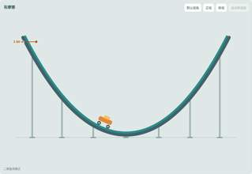
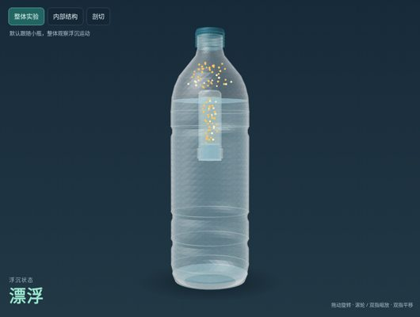
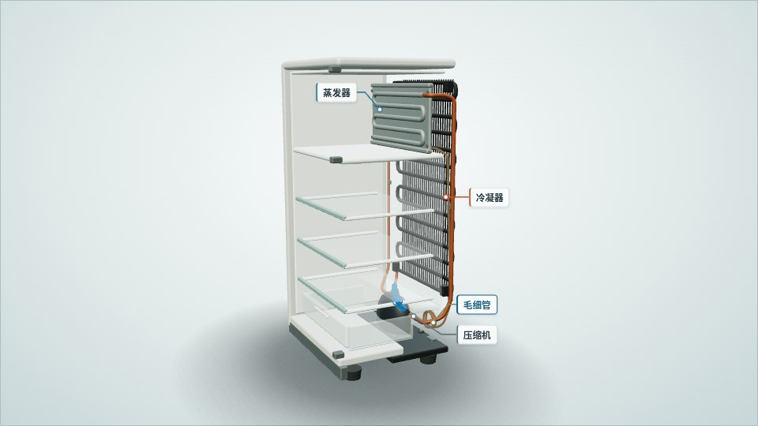
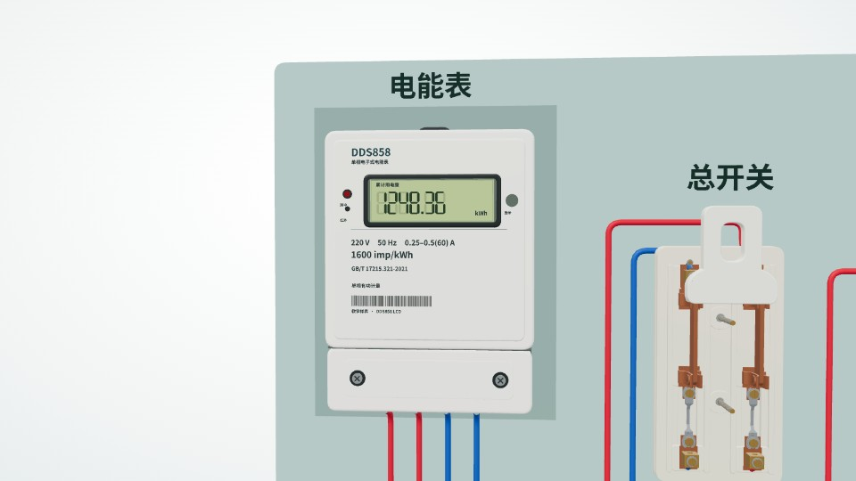

# 3D 交互物理实验室 · 3Dmodels

**让看不见的过程看得见，让抽象的物理规律可以亲手探究。**

面向初中物理课堂、实验教学、跨学科实践与学生自主探究的浏览器交互资源库。项目从教材实验出发，延伸到生活器具、工程技术和真实应用，将三维结构、动态过程、实验操作、物理量与图像联系起来。

**当前正式目录：89 个案例 · 14 个分类**（2026-11-28，依据 `catalog.js` 逐项统计；多实验页面按一个入口计。）

[在线体验 · 无需安装](https://zmdyy.github.io/3Dmodels/) · [完整案例目录](#完整案例目录) · [离线使用](#离线使用) · [开发与资源复用](#开发与资源复用) · [问题反馈](https://github.com/zmdyy/3Dmodels/issues)

## 为什么做这个项目？

- **看清结构**：通过旋转、缩放、平移、剖切与拆解，观察真实装置中难以直接看到的机构和连接关系。
- **看见过程**：逐步展示光路、浮沉、制冷、机械传动、电路通断及工程施工，适合课堂慢放与重点观察。
- **探究规律**：改变质量、速度、物距、液面高度、压强或电阻等变量，在支持的案例中观察示数、曲线与数据记录。
- **联系生活**：把教材中的知识迁移到自行车、冰箱、家庭电路、望远镜、高铁和桥梁等场景。
- **服务教学**：独立案例按需加载，可搜索、分类、新标签页打开；支持投影演示、小组探究、复习和课后自主学习。

## 场景预览

以下图片来自仓库现有案例封面，点击可直接进入在线交互页面。

| **运动与能量探究实验室** | **彩虹与霓 · 从一颗水滴到天空** | **浮沉子 · 定量探究实验** |
| --- | --- | --- |
| [](https://zmdyy.github.io/3Dmodels/models/motion-energy-lab.html?v=20261128-parallel) | [](https://zmdyy.github.io/3Dmodels/models/rainbow-and-secondary.html) | [](https://zmdyy.github.io/3Dmodels/models/cartesian-diver.html?v=20261125-v9-touch) |

| **冰箱把热送到哪里？** | **家庭电路** | **深中通道 E15 · 沉管浮运安装** |
| --- | --- | --- |
| [](https://zmdyy.github.io/3Dmodels/models/refrigerator-refrigeration.html) | [](https://zmdyy.github.io/3Dmodels/models/energy-meter.html?v=20261125-household-circuit) | [](https://zmdyy.github.io/3Dmodels/models/shenzhong-e15.html?v=20261026-v26) |

## 近期新增与重点案例

| 案例 | 教学与交互特点 |
|:---|:---|
| [力与平衡实验室](https://zmdyy.github.io/3Dmodels/models/force-balance-lab.html) | 七组交互力学实验，涵盖微小形变、弹簧测力计、重力、运动与惯性、二力平衡、摩擦力与二力的合成。支持触屏与单文件离线打开。 |
| [声音与振动实验室](https://zmdyy.github.io/3Dmodels/models/sound-vibration-lab.html) | 六组交互实验，从用乒乓球观察音叉微振动，到逐线超声成像。包含真空罩、音调与响度、共振、声呐测深和行车回波。单文件可离线使用。 |
| [运动与能量探究实验室](https://zmdyy.github.io/3Dmodels/models/motion-energy-lab.html?v=20261128-parallel) | 六阶段自主探究：阻力对运动的影响、动能与质量及速度、U形轨道、机械能转化、阻力与能量、过山车拓展。支持坡底测速、车载砝码、滑块位移色带、等时运动记录、可拖动对比浮窗及单次/连续播放。 |
| [水从哪里喷得更远？](https://zmdyy.github.io/3Dmodels/models/water-jet-range.html?v=20261126-drain) | 比较上、中、下孔出水速度与落点；移动单孔、调节水面和容器离地高度，探究液体压强与水平射程。自然排水默认开启，支持落点留痕、数据记录、射程曲线、正视及双指缩放和平移。 |
| [彩虹与霓 · 从一颗水滴到天空](https://zmdyy.github.io/3Dmodels/models/rainbow-and-secondary.html) | 从雨后天空进入单颗水滴，逐段观察折射与内反射，再切换观察者和彩虹、霓光锥，比较同一雨幕里哪些水滴能把光送入眼睛。 |
| [逆反射 · 自行车与高速公路](https://zmdyy.github.io/3Dmodels/models/retroreflection.html?v=20261125-v9-touch) | 切换夜间车灯与驾驶员视角，观察自行车反光片和高速公路护栏轮廓标；拆解一体成型微棱镜，依据教材二维作图探究两次反射，再逐次观察三维角锥的折射、反射与法线。支持双指缩放和平移。 |
| [浮沉子 · 定量探究实验](https://zmdyy.github.io/3Dmodels/models/cartesian-diver.html?v=20261125-v9-touch) | 挤压密封塑料瓶，观察浮沉子内气体压缩、进出水和浮沉运动。支持剖切、镜头跟随、双指缩放及平移、橙色水流箭头、气体示踪与实际排水区域高亮；独立计算浮力、重力与排水体积，实时曲线和 CSV 导出。单文件离线运行，瓶身形变和水流箭头为教学示意。 |
| [冰箱把热送到哪里？](https://zmdyy.github.io/3Dmodels/models/refrigerator-refrigeration.html) | 跟随制冷剂经过毛细管、蒸发器、压缩机和冷凝器，观察汽化吸热与液化放热。原位剖视可看活塞和进排气簧片开合，点击管内物态图可对照三种制冷剂的压强、沸点和熔点。 |
| [家庭电路](https://zmdyy.github.io/3Dmodels/models/energy-meter.html?v=20261125-household-circuit) | 操作照明、插座与空调支路，比较各负载功率与总功率。切换两种电能表，观察红色脉冲指示、铝盘转动、白炽灯升温与元件内部接线。 |
| [光的反射与折射](https://zmdyy.github.io/3Dmodels/models/reflection-refraction.html?v=20261126-sidebar-layout) | 切换亚克力、水和低折射率介质，拖动激光笔比较两侧入射。翻折刻度盘观察光迹，也可探究光路可逆、全反射与空间光路。 |
| [光与光谱实验室 · 色散、显色与视觉](https://zmdyy.github.io/3Dmodels/models/light-spectrum-color-vision.html?v=20261123-retina-anatomy) | 观察三棱镜色散、可见与不可见光、滤光和 RGB 像素显色。从眼球剖面逐级放大到视网膜与三维感光细胞，演示来光、信号传递和光转导，并可对照人体切片。 |
| [自行车 · 链传动、碟刹与简单机械](https://zmdyy.github.io/3Dmodels/models/bicycle-v346.html?v=20261101-controls-overview-v2) | 基于原始自行车 CAD 网格的高保真三维教学案例。演示脚踏曲柄与牙盘、链条和后飞轮、前叉转向、刹车把手与碟刹的联动，另含后轮浸水飞溅和摩擦力方向示意。提供演示、操作、视角、显示四个页签；部分铰接与水动力为教学重建近似模型。 |
| [汽车起重机 · 简单机械实验室](https://zmdyy.github.io/3Dmodels/models/mobile-crane-simple-machines.html?v=20261031-v20) | 汽车起重机三维交互教学：运输收拢、缓慢展开支腿、起重准备时挂住重物，以及卷扬起吊四阶段。可调回转、变幅、伸缩、卷扬和承重绳股数，结合滑轮组、杠杆、轮轴与支腿压强进行初中物理探究。内嵌模型数据，支持离线单文件运行。 |
| [生活中的杠杆 · 九种实物观察](https://zmdyy.github.io/3Dmodels/models/life-levers.html?v=20261108-contact-first) | 从九种生活物品观察支点、转轴、动力与阻力作用处，支持慢动作、进度拖动、蓝色操作点及实物照片对照。新增双手抬竿与双翼开瓶器旋入、拔塞过程。锤头滚动、瓶盖形变和机械联动均为定性教学演示，不用于真实力值计算。 |
| [浮力与密度实验室](https://zmdyy.github.io/3Dmodels/models/buoyancy-density-lab.html?v=20261102-glass-b22) | 五种实验联动三维装置、SVG曲线、测力计读数和重心受力图；支持液面升高层观察、点击放大、剖切、释放动画和液体密度对比。 |
| [深中通道 E15 · 沉管浮运安装](https://zmdyy.github.io/3Dmodels/models/shenzhong-e15.html?v=20261026-v26) | 演示船管协同浮运、受控沉放、着床精调、GINA 水力压接、内部止水、脱缆及回填；支持半透明海水、水下近景、局部剖视和手动接管镜头。 |
| [纸筒照相机 · 伸缩调焦](https://zmdyy.github.io/3Dmodels/models/paper-tube-camera.html?v=20261026-v1) | 固定盆景，移动照相机改变物距；伸缩纸筒恢复清晰，保存带厘米刻度、物距、像距和像高的同尺度对比卡。支持剖面光路、薄膜正视及对比图片导出。 |

## 完整案例目录

下表及展开列表根据 [catalog.js](./catalog.js) 生成。点击案例名称直接运行在线演示，点击「源码」查看对应 HTML 文件。旧入口、原型和离线副本不重复计数。

| 分类 | 数量 | 分类 | 数量 |
|:---|---:|:---|---:|
| 热学实验 | 9 | 光学现象 | 11 |
| 光学仪器 | 3 | 力学实验 | 30 |
| 综合应用 | 11 | 电学元件 | 7 |
| 电学实验 | 3 | 声学与电磁 | 6 |
| 能源与发电 | 3 | 家庭电路 | 2 |
| 通信与信息 | 1 | 精密机械 | 1 |
| 光与视觉 | 1 | 生活中的物理 | 1 |

<details>
<summary><strong>热学实验（9）</strong></summary>

- [冰箱把热送到哪里？](https://zmdyy.github.io/3Dmodels/models/refrigerator-refrigeration.html) — 制冷循环 · 压缩机簧片 · 水与霜 · [源码](./models/refrigerator-refrigeration.html)
- [高压锅 · 气压与安全机构](https://zmdyy.github.io/3Dmodels/models/pressure-cooker.html?v=20261103-v17) — 升压与排气 · 机械锁止 · 备用泄压 · [源码](./models/pressure-cooker.html)
- [不同燃料的热值 · 双灯探究实验](https://zmdyy.github.io/3Dmodels/models/fuel-calorific-value.html?v=20261116-chart-plaque) — 酒精与煤油 · 等质量燃料 · 水温变化 · [源码](./models/fuel-calorific-value.html)
- [海陆风 · 一天的呼吸](https://zmdyy.github.io/3Dmodels/models/sea-land-breeze.html?v=20261102) — 昼夜温差 · 近地面风 · 高空回流 · [源码](./models/sea-land-breeze.html)
- [干湿球温度计 · 蒸发吸热与空气湿度](https://zmdyy.github.io/3Dmodels/models/wet-dry-bulb-psychrometer.html?v=20261030-v11) — 双温度计 · 蒸发降温 · 湿度估算 · 放大读数 · [源码](./models/wet-dry-bulb-psychrometer.html)
- [温度计与热膨胀 · 九种结构探究](https://zmdyy.github.io/3Dmodels/models/thermometers-thermal-expansion.html?v=20261108-nav) — 水银狭道 · 双金属直片 · 波登管 · 金属杆 · 空气温度计 · [源码](./models/thermometers-thermal-expansion.html)
- [海波与石蜡 · 熔化与凝固实验室](https://zmdyy.github.io/3Dmodels/models/melting-freezing-lab.html?v=20261030-v12) — 水浴加热 · 物态显色 · 熔化平台 · 手动开始凝固 · [源码](./models/melting-freezing-lab.html)
- [观察水沸腾 · 三维精密实验室](https://zmdyy.github.io/3Dmodels/models/water-boiling.html?v=20261029-v12) — 酒精灯加热 · 气泡演化 · 分层水温 · 余热冷却 · [源码](./models/water-boiling.html)
- [水与食用油 · 比较吸热能力](https://zmdyy.github.io/3Dmodels/models/specific-heat-water-oil.html?v=20261027-v9) — 双杯同步加热 · 温度—时间图像 · 吃包子大赛 · [源码](./models/specific-heat-water-oil.html)

</details>

<details>
<summary><strong>光学现象（11）</strong></summary>

- [逆反射 · 自行车与高速公路](https://zmdyy.github.io/3Dmodels/models/retroreflection.html?v=20261125-v9-touch) — 反光片、护栏轮廓标与两次／三次反射 · [源码](./models/retroreflection.html)
- [光的折射 · 一池两世界](https://zmdyy.github.io/3Dmodels/models/refraction-island.html?v=20261110-water-surface) — 海湾观测站 · 水面上下 · 叉鱼挑战 · 弯折的铅笔 · [源码](./models/refraction-island.html)
- [光与光谱实验室 · 色散、显色与视觉](https://zmdyy.github.io/3Dmodels/models/light-spectrum-color-vision.html?v=20261123-retina-anatomy) — 三棱镜色散 · 可见与不可见光 · 滤光 · 显示器显色 · 视杆与视锥 · [源码](./models/light-spectrum-color-vision.html)
- [凹透镜成像规律](https://zmdyy.github.io/3Dmodels/models/concave-lens.html?v=20261021-1) — 正立缩小虚像与三条特殊光线 · [源码](./models/concave-lens.html)
- [彩虹与霓 · 从一颗水滴到天空](https://zmdyy.github.io/3Dmodels/models/rainbow-and-secondary.html) — 水滴光路 · 彩虹与霓光锥 · 观察者对照 · [源码](./models/rainbow-and-secondary.html)
- [光的反射与折射](https://zmdyy.github.io/3Dmodels/models/reflection-refraction.html?v=20261126-sidebar-layout) — 平面实验、光路可逆与空间拓展 · [源码](./models/reflection-refraction.html)
- [海市蜃楼](https://zmdyy.github.io/3Dmodels/models/mirage.html?v=20261018-nav1) — 上蜃、下蜃与弯曲光路 · [源码](./models/mirage.html)
- [平面镜成像规律](https://zmdyy.github.io/3Dmodels/models/plane-mirror.html?v=20261109-block-demo) — 玻璃板、等大蜡烛、像的位置与课本挡镜 · [源码](./models/plane-mirror.html)
- [凸透镜成像规律](https://zmdyy.github.io/3Dmodels/models/convex-lens.html?v=20261113-view-screen) — 3D光具座与2D光路联动实验 · [源码](./models/convex-lens.html)
- [小孔成像 · 自由探究](https://zmdyy.github.io/3Dmodels/models/pinhole-camera.html?v=20261123-pinhole-center-rays) — 开孔面积、孔形、物距与像距的三维观察 · [源码](./models/pinhole-camera.html)
- [月光下的积水 · 光的反射](https://zmdyy.github.io/3Dmodels/models/moonlight-puddle.html?v=20261026-b4) — 迎月与背月 · 镜面反射和漫反射 · [源码](./models/moonlight-puddle.html)

</details>

<details>
<summary><strong>光学仪器（3）</strong></summary>

- [纸筒照相机 · 伸缩调焦](https://zmdyy.github.io/3Dmodels/models/paper-tube-camera.html?v=20261026-v1) — 靠近与远离拍摄 · 像高测量与同尺度对比 · [源码](./models/paper-tube-camera.html)
- [折射式天文望远镜](https://zmdyy.github.io/3Dmodels/models/refracting-telescope.html?v=20261123-ray-directions) — 开普勒式 · 焦平面实像与目镜调焦 · [源码](./models/refracting-telescope.html)
- [牛顿式反射望远镜](https://zmdyy.github.io/3Dmodels/models/reflecting-telescope.html?v=20261018-nav1) — 凹面主镜 · 45°副镜 · 侧置目镜 · [源码](./models/reflecting-telescope.html)

</details>

<details>
<summary><strong>力学实验（30）</strong></summary>

- [浮沉子 · 定量探究实验](https://zmdyy.github.io/3Dmodels/models/cartesian-diver.html?v=20261125-v9-touch) — 气体压缩 · 进出水 · 浮力与排水体积 · [源码](./models/cartesian-diver.html)
- [机翼升力 · 流速与压强](https://zmdyy.github.io/3Dmodels/models/wing-lift.html) — 文丘里管 · 鼓风机 · 正置与倒置机翼 · [源码](./models/wing-lift.html)
- [热气球与飞艇 · 三维浮力实验室](https://zmdyy.github.io/3Dmodels/models/hot-air-balloon-airship.html) — 地面起飞 · 受力变化 · 尾舵特写 · [源码](./models/hot-air-balloon-airship.html)
- [大气压拓展 · 四个器物实验](https://zmdyy.github.io/3Dmodels/models/yin-yang-teapot.html?v=20261109-air-extension) — 普通壶 · 阴阳壶 · 公道杯 · 汲酒器 · [源码](./models/yin-yang-teapot.html)
- [三峡船闸 · 三室连通器](https://zmdyy.github.io/3Dmodels/models/three-gorges-ship-lock.html?v=20261104-v13) — 两室水位联动 · 地下输水 · 自动导演 · [源码](./models/three-gorges-ship-lock.html)
- [盆景自动补水装置](https://zmdyy.github.io/3Dmodels/models/automatic-plant-watering.html?v=20261103-gallery-v1) — 倒置储水瓶 · 水位自调节 · 大气压 · [源码](./models/automatic-plant-watering.html)
- [生活中的杠杆 · 九种实物观察](https://zmdyy.github.io/3Dmodels/models/life-levers.html?v=20261108-contact-first) — 开瓶器、食品镊、拉杆箱、独轮车、羊角锤、剪刀、指甲钳、钓鱼竿与双翼红酒开瓶器 · [源码](./models/life-levers.html)
- [生活中的轮轴 · 四种实物观察](https://zmdyy.github.io/3Dmodels/models/wheel-axle.html?v=20261108) — 螺丝刀、扳手、水龙头与水井辘轳 · [源码](./models/wheel-axle.html)
- [大气压与按压泵](https://zmdyy.github.io/3Dmodels/models/pressure-pumps.html?v=20261026-v4) — 洗手液泵与气囊取水器 · 双案例剖面 · [源码](./models/pressure-pumps.html)
- [绿豆密度 · 等体积替代](https://zmdyy.github.io/3Dmodels/models/mung-bean-density.html?v=20261026-1) — 四步实验、四次称量与物理量总览 · [源码](./models/mung-bean-density.html)
- [弹簧测力计 · 三种结构](https://zmdyy.github.io/3Dmodels/models/spring-force-meters.html?v=20261026-v8) — 圆筒式、条形盒式与开放式 · [源码](./models/spring-force-meters.html)
- [深中通道 E15 · 沉管浮运安装](https://zmdyy.github.io/3Dmodels/models/shenzhong-e15.html?v=20261026-v26) — 十阶段施工演示 · 分阶段自动跟随镜头 · [源码](./models/shenzhong-e15.html)
- [浮力的测量](https://zmdyy.github.io/3Dmodels/models/buoyancy-measurement.html?v=20261031-v3-pointer-2x) — 空气中称重 · 浸入液体 · 弹簧测力计精细读数 · [源码](./models/buoyancy-measurement.html)
- [浮力与密度实验室](https://zmdyy.github.io/3Dmodels/models/buoyancy-density-lab.html?v=20261102-glass-b22) — 标准实验、溢水杯、剪绳、底部拴绳与套杯托起 · [源码](./models/buoyancy-density-lab.html)
- [托盘天平 · 质量测量](https://zmdyy.github.io/3Dmodels/models/tray-balance.html?v=20261025-1) — 手动调零、砝码与游码配平、读数及误差 · [源码](./models/tray-balance.html)
- [筒车灌田 · 机械能转化](https://zmdyy.github.io/3Dmodels/models/water-wheel.html?v=20261023-1) — 水流驱动、竹筒提水与梯田灌溉 · [源码](./models/water-wheel.html)
- [阿基米德原理](https://zmdyy.github.io/3Dmodels/models/archimedes-principle.html?v=20261023-four-rows3) — 排水称重实验 · [源码](./models/archimedes-principle.html)
- [微小压强计](https://zmdyy.github.io/3Dmodels/models/micro-pressure-gauge.html?v=20261020-ortho2) — 橡皮膜、开口玻璃管与气流侧向取压 · [源码](./models/micro-pressure-gauge.html)
- [水从哪里喷得更远？](https://zmdyy.github.io/3Dmodels/models/water-jet-range.html?v=20261126-drain) — 液体压强 · 三孔喷水 · 出水速度与射程 · [源码](./models/water-jet-range.html)
- [手压抽水机](https://zmdyy.github.io/3Dmodels/models/piston-pump.html?v=20261018-ui1) — 引水、密封与两个单向阀的自由探究 · [源码](./models/piston-pump.html)
- [测量小车的平均速度](https://zmdyy.github.io/3Dmodels/models/car-speed.html?v=20261018-nav1) — 斜面小车、机械秒表与误差探究 · [源码](./models/car-speed.html)
- [力与平衡实验室](https://zmdyy.github.io/3Dmodels/models/force-balance-lab.html) — 力的作用 · 测力与重力 · 惯性 · 平衡 · 摩擦 · 合力 · [源码](./models/force-balance-lab.html) · [案例说明](./docs/reuse/cases/force-balance-lab.md)
- [运动与能量探究实验室](https://zmdyy.github.io/3Dmodels/models/motion-energy-lab.html?v=20261128-parallel) — 阻力与运动 · 动能影响因素 · 机械能转化 · [源码](./models/motion-energy-lab.html)
- [滑动摩擦力演示仪](https://zmdyy.github.io/3Dmodels/models/friction-belt.html?v=20261016-pointer-zoom-v2) — 传送带 · 二力平衡 · 弹簧测力计 · [源码](./models/friction-belt.html)
- [探究滑动摩擦力 · 手动拉动](https://zmdyy.github.io/3Dmodels/models/friction-manual-step.html?v=20261018-nav1) — Blender V9 · 弹簧测力计 · 静止到滑动 · [源码](./models/friction-manual-step.html)
- [古代杠杆工坊](https://zmdyy.github.io/3Dmodels/models/ancient-levers.html?v=20261018-nav1) — 桔槔、踏碓与单碓／四碓水力机械 · [源码](./models/ancient-levers.html)
- [潜水钟 · 空气与水压](https://zmdyy.github.io/3Dmodels/models/diving-bell.html?v=20261018-nav1) — 前海傍晚海岸中的存气、补气与水压观察 · [源码](./models/diving-bell.html)
- [滑轮实验室](https://zmdyy.github.io/3Dmodels/models/pulley-lab.html?v=20261018-nav1) — 定滑轮、动滑轮、滑轮组与等效杠杆 · [源码](./models/pulley-lab.html)
- [烧瓶潜水艇](https://zmdyy.github.io/3Dmodels/models/flask-submarine.html?v=20261102-glass-section-v5) — 双管烧瓶的进排水与浮沉 · [源码](./models/flask-submarine.html)
- [重力输液 · 玻璃瓶与软袋](https://zmdyy.github.io/3Dmodels/models/gravity-infusion.html?v=20261102-material-v4) — 独立进气、袋壁收缩与压差驱动 · [源码](./models/gravity-infusion.html)

</details>

<details>
<summary><strong>综合应用（11）</strong></summary>

- [电子秤 · 单点式称重传感器](https://zmdyy.github.io/3Dmodels/models/electronic-scale-single-point.html?v=20261104-v6) — 横梁形变 · 应变片 · 电桥与称重 · [源码](./models/electronic-scale-single-point.html)
- [自行车 · 链传动、碟刹与简单机械](https://zmdyy.github.io/3Dmodels/models/bicycle-v346.html?v=20261101-controls-overview-v2) — 真实 CAD · 踩踏传动 · 转向轮轴 · 刹车杠杆 · 后轮甩水 · [源码](./models/bicycle-v346.html)
- [汽车起重机 · 简单机械实验室](https://zmdyy.github.io/3Dmodels/models/mobile-crane-simple-machines.html?v=20261031-v20) — 四阶段作业流程 · 支腿 · 吊臂 · 滑轮组 · 卷扬 · [源码](./models/mobile-crane-simple-machines.html)
- [高铁，如何持续取电 · CR400AF](https://zmdyy.github.io/3Dmodels/models/cr400af-railway-power.html?v=20261030-v2) — 飞龙头车 · SWT-400E1 转向架 · 进出站自动导览 · 弓网取电 · [源码](./models/cr400af-railway-power.html)
- [自制气压计、温度计与微小形变](https://zmdyy.github.io/3Dmodels/models/capillary-three-experiments.html?v=20261102-glass-v13) — 玻璃瓶细管装置 · 三种物理探究 · [源码](./models/capillary-three-experiments.html)
- [钱塘江大桥 · 四阶段完整施工](https://zmdyy.github.io/3Dmodels/models/qiantang-bridge-complete.html?v=20261101-navigation-v3) — 射水打桩 → 沉箱浮运 → 压气筑墩 → 钢梁落潮架设 · [源码](./models/qiantang-bridge-complete.html)
- [油量测量装置](https://zmdyy.github.io/3Dmodels/models/fuel-gauge.html?v=20261018-nav1) — 浮子—滑杆—变阻器联动 · [源码](./models/fuel-gauge.html)
- [压力电子秤](https://zmdyy.github.io/3Dmodels/models/pressure-scale.html?v=20261029-v3) — 压敏电阻 · 七线实物接线 · 仪表读数 · 三页教学面板 · [源码](./models/pressure-scale.html)
- [身高体重测量仪](https://zmdyy.github.io/3Dmodels/models/height-weight-meter.html?v=20261018-nav1) — 测高、称重双支路与电表示数 · [源码](./models/height-weight-meter.html)
- [文物展台防盗报警装置](https://zmdyy.github.io/3Dmodels/models/museum-alarm.html?v=20261018-nav1) — 弹簧触点、短路旁路与电铃报警 · [源码](./models/museum-alarm.html)
- [水位自动报警器](https://zmdyy.github.io/3Dmodels/models/water-level-alarm.html?v=20261018-nav1) — 水位、继电器与红绿信号灯联动 · [源码](./models/water-level-alarm.html)

</details>

<details>
<summary><strong>电学元件（7）</strong></summary>

- [DZ47 系列参考 · 单极断路器内部结构](https://zmdyy.github.io/3Dmodels/models/dz47-breaker.html?v=20261024-v54) — 教学近似模型｜非原厂精确复刻；支持热磁脱扣演示 · [源码](./models/dz47-breaker.html)
- [三脚插头 · 地线先通后断](https://zmdyy.github.io/3Dmodels/models/three-pin-plug.html?v=20261103-4) — 三脚插头、金属机箱与保护接地的完整通路 · [源码](./models/three-pin-plug.html)
- [瓷底双刀闸刀开关](https://zmdyy.github.io/3Dmodels/models/porcelain-knife-switch.html?v=20261021-1) — 双刀联动、熔断连接片与瓷底装配结构 · [源码](./models/porcelain-knife-switch.html)
- [2×AA 电池盒](https://zmdyy.github.io/3Dmodels/models/battery-box.html) — 外壳、底座与串联结构 · [源码](./models/battery-box.html)
- [电位器](https://zmdyy.github.io/3Dmodels/models/potentiometer.html?v=20261018-nav1) — 旋钮、滑片与分压结构 · [源码](./models/potentiometer.html)
- [滑动变阻器](https://zmdyy.github.io/3Dmodels/models/rheostat.html?v=20261015-optional-diagram-v8) — 清晰环形接线、指针读表与灯泡亮度 · [源码](./models/rheostat.html)
- [电阻箱与插塞式电阻器](https://zmdyy.github.io/3Dmodels/models/resistance-boxes.html?v=20261019) — 旋转触片、插塞短路与接入阻值 · [源码](./models/resistance-boxes.html)

</details>

<details>
<summary><strong>电学实验（3）</strong></summary>

- [金属箔验电器 · 静电感应与电荷转移](https://zmdyy.github.io/3Dmodels/models/gold-leaf-electroscope.html?v=20261101-v104-gallery) — 橡胶棒/玻璃棒 · 正负电荷 · 单双验电器 · 接地与分电 · [源码](./models/gold-leaf-electroscope.html)
- [地磅 · 载重与电流](https://zmdyy.github.io/3Dmodels/models/weighbridge.html?v=20261024-1) — 弹簧、滑片与电流表联动 · [源码](./models/weighbridge.html)
- [焦耳定律](https://zmdyy.github.io/3Dmodels/models/joule-law.html?v=20261020-shared1) — 比较电阻与电流对电热的影响 · [源码](./models/joule-law.html)

</details>

<details>
<summary><strong>声学与电磁（6）</strong></summary>

- [声音与振动实验室](https://zmdyy.github.io/3Dmodels/models/sound-vibration-lab.html) — 声音的产生和传播 · 真空罩 · 声音特性 · 共振 · 回声与超声 · [源码](./models/sound-vibration-lab.html) · [案例说明](./docs/reuse/cases/sound-vibration-lab.md)
- [地球磁场 · 指南针探究](https://zmdyy.github.io/3Dmodels/models/earth-magnetism.html?v=20261024-1) — 任意位置安放指南针，观察磁偏角与磁倾角 · [源码](./models/earth-magnetism.html)
- [安培定则](https://zmdyy.github.io/3Dmodels/models/ampere-rule.html) — 机器人右手握持与螺线管磁极判断 · [源码](./models/ampere-rule.html)
- [电动机原理 · 四个3D实验](https://zmdyy.github.io/3Dmodels/models/motor-principles.html?v=20261018-nav1) — 导体受力、手动换向、刮漆与换向器 · [源码](./models/motor-principles.html)
- [扬声器结构与振动](https://zmdyy.github.io/3Dmodels/models/speaker.html) — 纸盆、音圈与磁隙的装配关系 · [源码](./models/speaker.html)
- [动圈式话筒](https://zmdyy.github.io/3Dmodels/models/dynamic-microphone.html) — 金属网罩、膜片与动圈拾音单元 · [源码](./models/dynamic-microphone.html)

</details>

<details>
<summary><strong>能源与发电（3）</strong></summary>

- [单缸四冲程汽油机](https://zmdyy.github.io/3Dmodels/models/four-stroke-engine.html?v=20261019-layout2) — 观察冲程、曲轴转数与能量转化 · [源码](./models/four-stroke-engine.html)
- [核能发电](https://zmdyy.github.io/3Dmodels/models/nuclear-power.html) — 反应堆、汽轮机与发电机 · [源码](./models/nuclear-power.html)
- [塔式太阳能电站](https://zmdyy.github.io/3Dmodels/models/solar-tower.html?v=20261122-optics) — 参照敦煌 100 MW 熔盐塔式光热电站 · [源码](./models/solar-tower.html)

</details>

<details>
<summary><strong>家庭电路（2）</strong></summary>

- [家庭电路](https://zmdyy.github.io/3Dmodels/models/energy-meter.html?v=20261125-household-circuit) — 分支功率 · 电子式与机械式电能表 · 氖管式试电笔 · [源码](./models/energy-meter.html)
- [螺口灯泡装配与接线](https://zmdyy.github.io/3Dmodels/models/e27-bulb.html?v=20261018-nav1) — E27 灯泡、灯座与家庭电路 · [源码](./models/e27-bulb.html)

</details>

<details>
<summary><strong>通信与信息（1）</strong></summary>

- [通信卫星与全球通信](https://zmdyy.github.io/3Dmodels/models/communication-satellite.html) — 同步卫星、天宫空间站与天地通信 · [源码](./models/communication-satellite.html)

</details>

<details>
<summary><strong>精密机械（1）</strong></summary>

- [机械秒表（停表）](https://zmdyy.github.io/3Dmodels/models/stopwatch.html) — 装配、分解与计时机构 · [源码](./models/stopwatch.html)

</details>

<details>
<summary><strong>光与视觉（1）</strong></summary>

- [眼睛的调节与视角](https://zmdyy.github.io/3Dmodels/models/eye-accommodation.html) — 晶状体调焦、视网膜成像与可辨细节 · [源码](./models/eye-accommodation.html)

</details>

<details>
<summary><strong>生活中的物理（1）</strong></summary>

- [地漏存水杯与水封](https://zmdyy.github.io/3Dmodels/models/floor-drain-trap.html?v=20261018-nav1) — 连通器 · 剖面 · 排水防臭 · [源码](./models/floor-drain-trap.html)

</details>

## 快速开始

### 直接在线使用（教师与学生推荐）

打开 [3D 交互物理实验室](https://zmdyy.github.io/3Dmodels/)，按分类或知识点搜索案例，点击卡片进入实验。无需安装软件或 npm 依赖；推荐新版 Chrome / Edge，三维页面需要 WebGL 支持。

### 本地部署

```bash
git clone https://github.com/zmdyy/3Dmodels.git
cd 3Dmodels
python -m http.server 8000
```

打开 http://localhost:8000/ 。也可使用 VS Code Live Server 或其他静态 HTTP 服务器。Python 仅用于启动服务器，并非浏览实验的运行时依赖。完整部署需保留 `index.html`、`catalog.js`、`models/`、`shared/`、`assets/` 等资源。普通仓库 HTML 不建议直接通过 file:// 双击运行，因为跨文件模块、GLB、纹理可能受浏览器限制。

## 离线使用

- **单案例离线**：已将引擎、脚本、纹理和模型完整内嵌的 HTML 可直接双击运行；普通案例源文件不保证独立离线。
- **中文命名单文件导出**：仓库包含 [导出工作流](https://github.com/zmdyy/3Dmodels/actions/workflows/export-chinese-offline.yml) 与 [导出脚本](./scripts/export-offline-gallery.py)。工作流可手动触发，产物包含中文命名 HTML 与导出检查报告；有警告的案例应继续复核，导出成功不代表全部通过断网运行测试。
- **整仓离线**：下载完整仓库后使用本地 HTTP 服务器，逐项确认没有外部 CDN/API 请求。高铁 CR400AF 案例需要保留其本地资源分包。

开发者可执行：

```bash
npm install --no-save --no-audit --no-fund esbuild@0.25.12
python scripts/export-offline-gallery.py
```

## 操作说明

| 操作 | 用途 |
|:---|:---|
| 左键拖动 | 旋转观察视角；拖动实验部件时遵循案例自身操作 |
| 滚轮 | 缩放 |
| 右键拖动 / Shift + 左键拖动 | 平移观察视角 |
| 双指缩放 / 双指平移 | 支持触屏手势的案例可直接操作；旧案例需逐项验证 |
| 复位、剖切、放大、播放、暂停 | 按案例提供的功能使用 |

部分二维实验有专用交互。手动调整视角应中断自动跟随，用户主动恢复后再继续。详见 [导航约定](./docs/navigation.md)。

## 开发与资源复用

以 Three.js / WebGL 为主要三维技术，结合 SVG、Canvas、React（部分案例）与 Blender / glTF（部分模型）。新公共三维资源使用本地 Three.js r160；历史案例保留各自适用的引擎与实现，不强制统一重构。

新增案例时优先使用现成器材和交互模块：玻璃容器与液体光影、10 N 测力计、可调铁架台、SVG 刻度与数字、课堂字号、视角控制，以及圆形定位放大镜、原面板矩形放大、可缩放读数窗三类放大方式。

**使用 AI 制作新案例前，先读 [AGENTS.md](./AGENTS.md)，检索资源，再建模：**

```bash
python scripts/reuse-context.py --query "实验需求" --engine three-r160
python scripts/reuse-context.py --list
python scripts/reuse-context.py --validate
```

[资源目录](./docs/reuse/README.md) · [API](./docs/reuse/API.md) · [放大样式](./docs/reuse/DETAIL-PATTERNS.md) · [组装演示](./examples/reuse-lab.html) · [离线组装演示](./examples/reuse-lab-offline.html) · [放大对照](./examples/instrument-details.html) · [验收记录](./docs/reuse/VALIDATION.md)

### 仓库结构

```text
3Dmodels/
├── index.html         # 在线作品集：搜索、分类、独立案例查看器
├── catalog.js         # 正式案例元数据与目录统计来源
├── models/            # 独立案例、配套脚本和模型资源
├── assets/covers/     # 案例封面
├── shared/           # 公共材质、交互组件和本地引擎
│   ├── lab-kit/       # 公共实验资源及注册表
│   └── vendor/        # 本地依赖及许可
├── examples/         # 复用示例及离线演示
├── docs/             # 教学原理、技术约定与验收记录
├── scripts/          # 导入、导出、截图与测试
├── AGENTS.md         # AI 开发与维护规则
├── MATERIALS.md      # 材质与质感规范
└── README.md
```

首页根据 catalog.js 渲染卡片，只有打开案例时才加载对应页面；关闭查看器后卸载 iframe，避免多个 WebGL 场景同时占用资源。

### 新增案例与维护

1. 核实物理原理、器材结构、连接关系、单位与实验变量；明确教学近似。
2. 检索公共资源并制定实验流程，优先复用成熟部件与真实接口。
3. 制作独立 `models/<ascii-id>.html`，验收运动连续性、物理量、光路、装配、遮挡与读数。
4. 在 catalog.js 登记唯一 ID、标题、副标题、分类、摘要、标签、路径、图标及配色；有真实画面时添加封面。
5. 检查默认视角、鼠标与触屏、播放和复位、搜索及分类、离线依赖、截图和必要测试。
6. 同步更新 README 中的统计与目录；新增公共资源时补齐注册表、API、来源、示例和验收证据。

可用 `python scripts/add-model.py ./新案例.html --id new-demo --category 力学实验 --tags 密度,测量` 辅助登记。该脚本对特定旧版内嵌 Three.js 的处理可能引入 CDN，离线交付时必须检查实际依赖。

[材质规范](./MATERIALS.md) · [导航约定](./docs/navigation.md) · [封面规范](./docs/gallery-covers.md) · [历史开发记录](./docs/README_HISTORY_2026-10-29.md)

## 准确性、适用范围与版权

- 本项目是教学交互演示，而非测量仪器校准软件、真实工程施工指导、工业级 CAD 或安全操作指南。部分剖切、颜色、示踪、比例、时间和形变采用教学放大或近似处理。
- 支持定量数据的案例也应结合假设、参数范围和理想化条件解释；不能用虚拟实验替代必要的真实实验。家庭电路及高压设备仅用于课堂模拟，不作为带电操作或拆修指南。
- [DZ47 断路器](./docs/dz47-breaker.md) 是单极热磁脱扣教学近似，并非原厂 1:1 制造图。
- 第三方库、纹理及参考素材遵守各自许可；见 [Three.js MIT 许可](./shared/vendor/THREE-LICENSE.txt)。仓库公开不等于全部内容均授权自由商用或二次分发。

---

**在线实验室：** [zmdyy.github.io/3Dmodels](https://zmdyy.github.io/3Dmodels/)  
**项目仓库：** [github.com/zmdyy/3Dmodels](https://github.com/zmdyy/3Dmodels)  
**反馈与建议：** [GitHub Issues](https://github.com/zmdyy/3Dmodels/issues)
